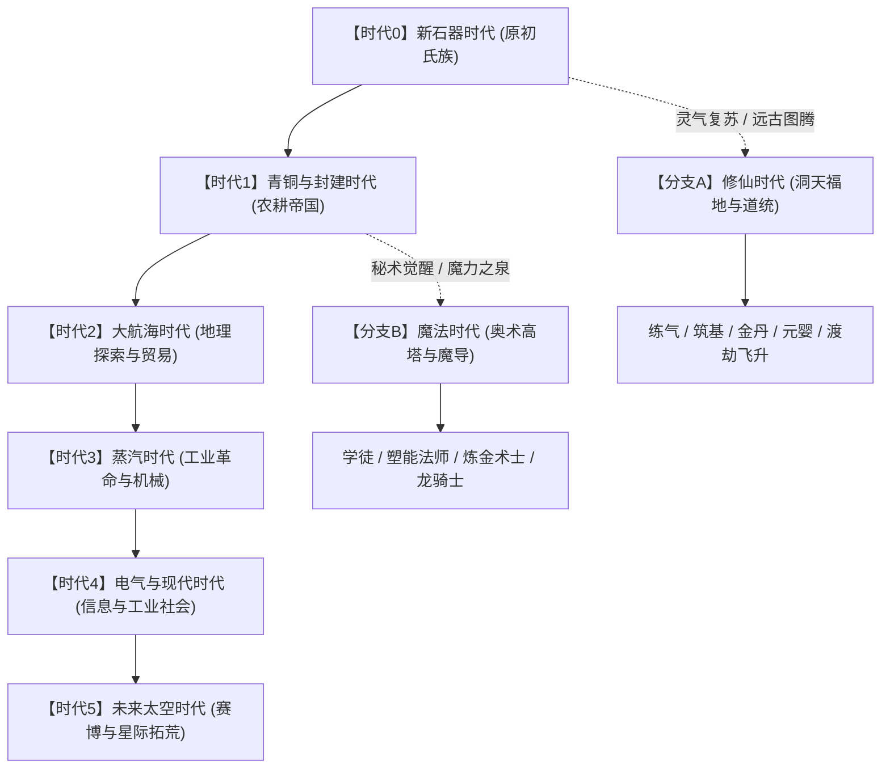
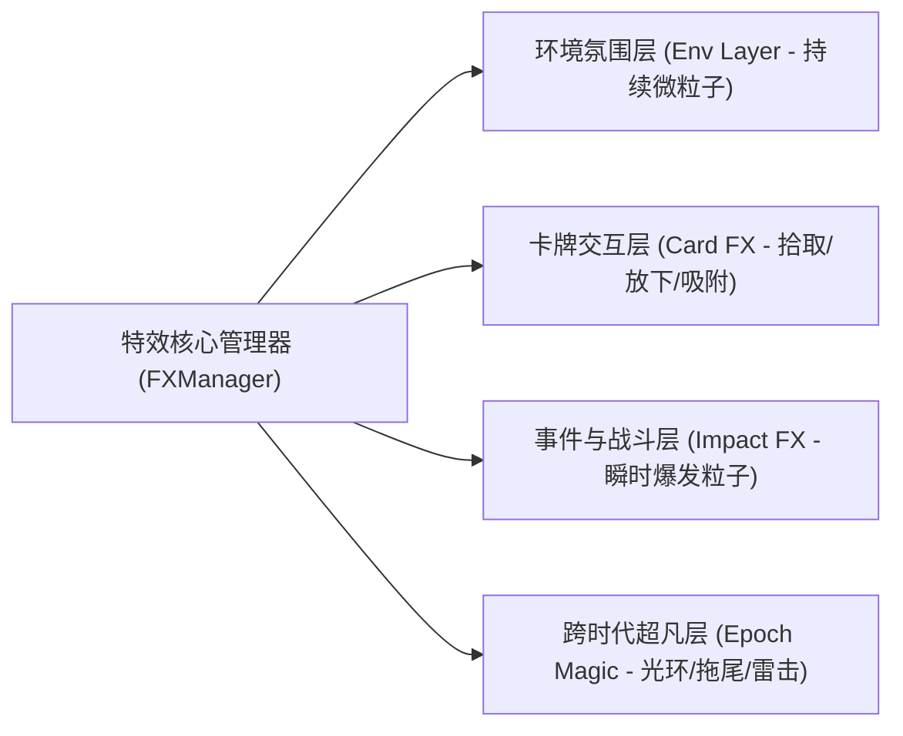

# 《卡牌世界》全时代演化与全维度资源矩阵扩充蓝图

> 本蓝图为《卡牌世界》（Card World）面向“无限人生与人类文明演进”的长线资源规划与美术、特效工程体系。涵盖从原始氏族到星际探索的现实科技线，以及东玄修仙、西陆魔法两大幻想分流分支。

---

## 一、 宏观世界观演进拓扑 (The Grand Epoch Topology)

---

## 二、 跨时代卡牌资源矩阵规划

每个时代细分为 **人物（Roles）**、**建筑与设施（Buildings）**、**工具装备与武器（Gear）**、**生活物资与关键能源（Goods & Power）** 四大核心库。

### 1. 【时代 0】新石器原始时代 (Neolithic) —— 当前阶段已基本完备
* **调性**：粗陶、骨石器、红褐黏土、葛麻、原木、兽皮，朴拙温暖的大地色系。
* **人物**：氏族少年（主角）、陶工陶婶、农夫阿三、石匠阿砺、采芦女阿苇、老渔翁阿罟、货郎阿贾、部落祭司。
* **设施**：半地穴茅草屋、窝棚、共用陶窑、高脚公仓、土石公灶、火塘、晾坯木架、木栅栏。
* **工具与武器**：打制石斧、燧石刀、石锄、长木石矛、麻编渔网、松脂火把、石锤、独木舟。
* **物资与生存**：粟米穗、鲜兽肉、河鱼、湿黏土、粗麻绳、生皮、干芦苇、草木灰、骨针、陶罐、熟粟饭。

---

### 2. 【时代 1】青铜与封建时代 (Bronze & Feudal Age)
* **调性**：青铜冷绿斑驳、汉瓦砖红、漆器黑金、宣纸墨韵，结构严整的斗拱与夯土城垛。
* **人物 (Roles)**：
  - `blacksmith.png` 铁匠/铜匠（赤膊围皮围裙、执铁钳与锤）
  - `scholar.png` 儒生/账房（纶巾青衫、执毛笔竹简）
  - `farmer_feudal.png` 佃农夫妻（斗笠短褐、挽裤脚）
  - `guard_soldier.png` 披甲步卒（铜盔皮甲、手执长戈）
  - `innkeeper.png` 驿站掌柜（布冠长袍、腰悬算盘）
  - `herbalist.png` 采药郎中（背竹编药篓、手拿小药锄）
* **建筑与设施 (Buildings)**：
  - `smithy.png` 铁匠铺（红砖风箱炉、砧台与水槽）
  - `granary_brick.png` 青砖大粮仓（石台基、硬山顶）
  - `tavern.png` 迎风客栈（挑出酒旗、两层木楼）
  - `watermill.png` 溪流石磨水车（转动木水轮驱动石碾）
  - `city_gate.png` 城门要塞（青砖包砌拱券门、带女墙）
  - `academy.png` 乡塾学堂（案几、屏风与砚台）
* **装备与武器 (Gear)**：
  - `bronze_sword.png` 青铜剑（规整菱格纹、绿锈与寒光）
  - `crossbow.png` 机械铜机弩（桦木弩臂、青铜机牙）
  - `iron_plow.png` 铁犁铧（牛拉翻土双刃铁犁）
  - `shield_wood.png` 蒙皮木盾（朱红漆兽面纹）
  - `bamboo_slip.png` 编绳竹简卷轴（记载手艺配方与赋税）
* **物资与商品 (Goods & Power)**：
  - `copper_ore.png` 孔雀石铜矿石、`iron_ingot.png` 熟铁锭、`silk_roll.png` 桑蚕丝绸匹练、`tea_brick.png` 压实紧压茶砖、`coin_copper.png` 方孔圆钱串、`ceramic_glazed.png` 青瓷碗盘。

---

### 3. 【时代 2】大航海与地理发现时代 (Age of Sail & Exploration)
* **调性**：黄铜罗盘、深海浪花、羊皮航海图、厚重帆布、火绳枪药桶与橡木酒桶。
* **人物 (Roles)**：
  - `captain.png` 远洋船长（三角帽、排扣双排呢外套、单筒望远镜）
  - `navigator.png` 领航学者（手拿六分仪与圆规海图）
  - `corsair.png` 劫掠海盗（头裹红巾、带眼罩、腰插燧发铳）
  - `merchant_spice.png` 香料巨贾（丝绒滚边锦袍、托天平秤）
  - `gunner.png` 战舰炮手（头扎布巾、扛通条与点火铁钎）
* **建筑与设施 (Buildings)**：
  - `galleon.png` 三桅盖伦帆船（高艉楼、膨胀白帆、侧舷炮门）
  - `lighthouse.png` 石砌灯塔（螺旋石梯、顶层反光铜镜火盆）
  - `wharf_crane.png` 港口木滑轮吊机（吊装大货箱）
  - `distillery.png` 朗姆酒蒸馏作坊（紫铜冷凝管与橡木熟化桶）
  - `trading_post.png` 商会货栈（高垛木箱、称重磅秤）
* **装备与武器 (Gear)**：
  - `flintlock.png` 燧发短手枪（黄铜雕花、燧石夹头）
  - `cutlass.png` 弧形水手弯刀（粗实黄铜护手镡）
  - `spyglass.png` 伸缩黄铜单筒望远镜
  - `sextant.png` 象限六分仪（精密黄铜刻度弧）
  - `compass_marine.png` 航海磁罗经（陀螺万向架底座）
* **物资与特产 (Goods & Power)**：
  - `spices.png` 粗麻袋装肉豆蔻胡椒、`tobacco.png` 烟草叶捆、`rum_cask.png` 橡木烈酒桶、`silver_bars.png` 白银条锭、`sugar_cone.png` 纸包圆锥精糖、`gunpowder.png` 密封黑火药桶。

---

### 4. 【时代 3】蒸汽与工业革命时代 (Industrial Steam & Steel)
* **调性**：铸铁黑、齿轮黄铜色、锅炉高压蒸汽白、煤炭深黑与烟囱红砖。
* **人物 (Roles)**：
  - `train_driver.png` 司炉列车长（防风护目镜、皮手套、手握气阀扳手）
  - `factory_laborer.png` 纺织女工/机修工（工装连体服、沾油污）
  - `steampunk_inventor.png` 机械学者（机械发条单片镜、皮带胸包）
  - `tycoon.png` 工业托拉斯资本家（大礼帽、金怀表链、雪茄）
  - `miner_coal.png` 煤矿井下工人（头灯安全帽、肩扛铁镐）
* **建筑与设施 (Buildings)**：
  - `steam_engine.png` 瓦特联动蒸汽机（巨大的铸铁飞轮与往复活塞杆）
  - `blast_furnace.png` 炼钢高炉（红砖外壳、出铁口流淌金红铁水）
  - `factory_smokestack.png` 蒸汽纺织大厂房（成排红砖高耸烟囱喷烟）
  - `railway_depot.png` 铁道车站与蒸汽机车头（粗壮排气管、前置巨大撞角）
  - `gas_lamp.png` 铸铁街头瓦斯路灯
* **装备与武器 (Gear)**：
  - `wrench_heavy.png` 重型铸铁活动管钳
  - `revolver.png` 左轮连发转轮手枪
  - `gatling.png` 手摇手摇加特林多管转膛机枪
  - `pocket_watch.png` 齿轮游丝精密开面怀表
* **物资与能源 (Goods & Power)**：
  - `coal_chunk.png` 高能焦煤块、`steel_beam.png` 工字型重钢梁、`steam_pressure.png` 高压蒸汽罐、`lubricant.png` 润滑机油桶、`wire_copper.png` 漆包细铜线圈。

---

### 5. 【时代 4】电气与现代时代 (Modern & Information Age)
* **调性**：硅芯片碧绿、冷光蓝霓虹、电镀拉丝铝银、混凝土灰与发光液晶屏。
* **人物 (Roles)**：
  - `programmer.png` 软件工程师/黑客（连帽衫、敲击发光键盘、耳机）
  - `doctor_surgeon.png` 现代外科医师（蓝色手术服、听诊器、医用口罩）
  - `lab_scientist.png` 穿白大褂研究员（手持离心试管分析架）
  - `patrol_cop.png` 现代巡警（对讲机、执法记录仪、警用大檐帽）
  - `pilot.png` 民航机长（双排金杠制服、飞行雷朋太阳镜）
* **建筑与设施 (Buildings)**：
  - `server_farm.png` 恒温数据中心（机架排布指示灯闪烁的服务器阵列）
  - `skyscraper.png` 玻璃幕墙摩天写字楼
  - `hospital.png` 综合现代医院（屋顶急救直升机坪）
  - `solar_array.png` 光伏光热电站（成排深蓝太阳能硅晶板）
  - `highway.png` 多车道立交高架桥与柏油公路
* **装备与科技物品 (Gear)**：
  - `smartphone.png` 智能全屏触控手机、`laptop.png` 便携超极笔记本电脑
  - `drone.png` 四旋翼民用侦察无人机、`defibrillator.png` 便携除颤仪
  - `assault_rifle.png` 战术卡宾步枪（导轨红点瞄准镜）
* **物资与核心介质 (Goods & Power)**：
  - `silicon_wafer.png` 彩虹光泽硅晶圆芯片、`lithium_battery.png` 动力锂电池组、`antibiotics.png` 抗生素药丸胶囊板、`petroleum.png` 桶装原油、`optical_fiber.png` 光纤束。

---

### 6. 【时代 5】未来太空与星际时代 (Sci-Fi Frontier)
* **调性**：反重力流线型钛白、全息投影微青、离子引擎幽蓝、曲率引擎炫光。
* **人物 (Roles)**：
  - `cyborg_scout.png` 机械改造斥候（半机械义体、热成像仿生义眼）
  - `starship_admiral.png` 星舰舰队指挥官（银白星系服、神经共鸣头冠）
  - `terraformer.png` 行星地貌改造工程师（重型增压宇航服、地质采样光炮）
  - `ai_avatar.png` 舰载人工智能实体拟真投影
* **建筑与巨构 (Buildings)**：
  - `orbital_elevator.png` 太空轨道电梯（巨型缆索直插云霄与轨道站）
  - `fusion_reactor.png` 可控核聚变托卡马克反应堆（磁约束等离子体光环）
  - `dyson_swarm.png` 恒星戴森云集能面板阵列
  - `jump_gate.png` 超空间跃迁星门（悬浮巨型反重力环形门）
* **装备与武器 (Gear)**：
  - `plasma_blade.png` 约束等离子光刃刀柄
  - `railgun.png` 电磁轨道炮（双磁极发光导轨）
  - `exoskeleton.png` 动力外骨骼装甲（液压支撑杆与碳纤维肌束）
  - `nanite_injector.png` 纳米机械自愈修复注射器
* **战略资源 (Goods & Power)**：
  - `antimatter_pod.png` 磁悬浮反物质封存胶囊、`dark_matter.png` 暗物质晶体块、`quantum_core.png` 量子纠缠计算核心、`energy_cell.png` 高密度零点能电池。

---

### 7. 【奇幻分流 A】东方修仙时代 (Xianxia & Cultivation)
* **调性**：天青烟雨、祥云朱砂、青玉莹润、紫电金雷、古剑飘逸。
* **阶梯境界人物 (Roles)**：
  - `cultivator_novice.png` 炼气入门道童（道髻粗布道袍、手捧心法残卷）
  - `sword_immortal.png` 筑基御剑剑修（白衣胜雪、并指引诀、飞剑环绕）
  - `alchemist_dan.png` 金丹炼丹长老（八卦云肩鹤氅、轻拂拂尘）
  - `grandmaster.png` 元婴/化神渡劫老祖（鹤发童颜、脑后悬浮神光宝轮）
  - `spirit_fox.png` 化形灵狐 / 伴生灵兽白虎
* **建筑与洞天 (Buildings)**：
  - `alchemy_furnace.png` 九转紫金炼丹八卦炉（炉身铭刻二十四节气符文）
  - `spirit_spring.png` 悬崖灵泉聚灵阵（泉眼泛起青翠灵雾）
  - `sword_shrine.png` 万剑归宗洗剑池（倒插数千柄残剑的灵石古坛）
  - `scripture_pavilion.png` 凌空飞檐藏经飞阁（云海托起的万卷玉简殿）
  - `tribulation_platform.png` 渡劫引雷仙台（镌刻辟邪雷纹的青铜巨柱）
* **法宝与道兵 (Gear)**：
  - `flying_sword.png` 灵犀飞剑（剑身流淌天青色剑芒流光）
  - `talisman_fire.png` 朱砂烈火道符（黄裱纸勾勒上清真敕火纹）
  - `spirit_gourd.png` 养剑温酒紫金葫芦
  - `bag_of_holding.png` 乾坤储物袋（织锦锦囊内有须弥空间）
  - `heavenly_mirror.png` 照妖八卦青铜古镜
* **灵材与宝药 (Goods & Power)**：
  - `spirit_stone.png` 极品五行灵石、`zhuji_pill.png` 筑基丹、`thousand_year_ginseng.png` 千年化形人形老山参、`dragon_scale.png` 真龙脱落青逆鳞、`phoenix_feather.png` 浴火涅槃真凤羽。

---

### 8. 【奇幻分流 B】西方高塔魔法时代 (High Fantasy Magic)
* **调性**：奥术深紫、羊皮卷金黄、星盘黄铜、魔杖宝石虹彩、地脉荧绿。
* **人物 (Roles)**：
  - `apprentice.png` 魔法学徒（厚重兜帽斗篷、笨拙托捧厚皮法典）
  - `archmage.png` 奥术大法师（星空刺绣法袍、手握镶嵌发光魔能水晶法杖）
  - `necromancer.png` 死灵通灵术士（白骨项圈、掌心托骨火幽魂）
  - `ranger_elven.png` 精灵游侠（翡翠皮甲、雕花长弓与附魔箭矢）
  - `paladin.png` 圣殿光辉圣骑士（全套秘银重板甲、背负神圣大剑）
* **建筑与秘所 (Buildings)**：
  - `wizard_tower.png` 旋转悬空石砌奥术高塔（顶端悬浮聚魔水晶球）
  - `mana_font.png` 地底魔力涌动之泉（泛着荧紫光辉的井口）
  - `enchanting_table.png` 附魔祭坛（悬浮自动翻页发光古书、刻满如尼文字）
  - `gryphon_roost.png` 狮鹫兽群驯养高巢（峭壁木架与巨型兽巢）
  - `portal_gate.png` 恶魔/传送界门（扭曲旋转的深渊虚空涡流）
* **魔导与武装 (Gear)**：
  - `crystal_staff.png` 水晶大魔杖（蟠曲古木顶嵌闪烁法球）
  - `spellbook.png` 龙皮绑带附魔厚典（封皮刻有发光五芒星印记）
  - `wand_holly.png` 冬青木凤凰尾羽魔杖
  - `mithril_shield.png` 秘银破魔圆盾（镜面反光格挡诅咒）
* **魔法物料 (Goods & Power)**：
  - `mana_potion.png` 荧光蓝魔力恢复药剂瓶、`health_flask.png` 红宝石色治愈药剂、`dragon_heartstring.png` 巨龙心腱、`astral_dust.png` 闪耀星界粉末、`void_shard.png` 虚空幽暗碎片。

---

## 三、 动态特效系统（VFX / Particle Dynamics）架构

为适配卡牌世界的纯 Web 前端栈（Canvas 2D + DOM 叠层），特效系统保持**轻量级无依赖、GPU 高速合成、物理行为即插即用**。

### 1. 特效分类清单与实现方式

| 特效类型 | 表现场景 | 视觉形态 | 实现技术 |
| :--- | :--- | :--- | :--- |
| **生火与烹饪** | 火塘、公灶、陶窑生火运转时 | 灰白色烟圈袅袅上升扩散消散，细小金橙火星偶尔迸发 | Canvas 2D 粒子池（50粒子循环） |
| **铁与石之碰撞** | 石器制作、铁匠锻造、挖矿 | 3-6 颗灰白碎屑或明黄铁火星呈抛物线四散弹跳并衰减消失 | 极速矢量点重力弹跳模拟 |
| **自然季候流转** | 春季落英、秋天红枫、冬日落雪、雷雨骤降 | 全屏幕半透明落叶/飘雪，受到风向正弦波动影响 | 独立的 `weather.js` Canvas 粒子层 |
| **卡牌合成突破** | 新配方领悟、时代科技点亮、建筑封顶 | 环形金色神光冲击波向外展开，伴随柔和金色星尘上浮 | CSS 关键帧动画 + 动态 Canvas 耀斑 |
| **蒸汽与机械排气** | 蒸汽机启动、火车发车、工矿作坊 | 浓厚白色高压气团快速膨胀并向侧后方翻滚淡化 | 径向渐变圆叠加 Perlin 噪点位移 |
| **灵气流转 / 魔法拖尾** | 飞剑巡逻、魔法施法、丹炉出丹 | 剑身后留下一抹渐隐青光/紫光贝塞尔光带拖尾（Ribbon Trail） | Canvas 历史坐标连接生成动态 Mesh 光带 |
| **雷劫天降 / 闪电法术** | 渡劫天雷、轨道炮射击、过载短路 | 从天顶瞬间生成折线分叉的惨白蓝紫闪电，带强光暗角闪屏 | 递归中点位移算法（Midpoint Displacement）闪电 |

---

## 四、 角色群像与人物生态系统 (NPC Mind & Destiny)

卡牌世界的人物绝不仅仅是一张图标，而是具备**阶层、性格、职业手艺、家庭社交链与时代命途**的完整生命体：

1. **多代传承机制**：
   - 石器时代的少年老去后，将石斧与打石技艺传给子女；
   - 封建时代后，子承父业或通过私塾考取功名转职；
   - 现代时代通过高校与职业工种分化；
   - 修仙时代则可通过灵根检测从凡人凡骨拜入山门斩断尘缘。
2. **立绘规范与视觉演化**：
   - 保持 256×256 统一规格半身像。
   - 随年龄增长实时切换：幼童（萌系） -> 青年（英武/秀丽） -> 中年（沉稳带胡茬/发髻） -> 暮年（鹤发慈祥）。

---

## 五、 自动化资产生产管线 (Automated Pipeline)

依托我们已完全打通的 **Hark 94 号池 + 无头渲染管线**：

1. **批量生成自动化**：
   - 编写 `batch_generate_era.py` 调度脚本，只需传入该时代的物资清单。
   - 线程池并发向 Hark 号池分发 Prompt，批量吐出严谨规范的 SVG 标签。
2. **多通道导出**：
   - `art/svgs/<era>/<name>.svg` 保存原始矢量源。
   - 无头 Edge 浏览器在后台毫秒级渲染为 `art/icons/<name>.png`（256×256 纯净透明通道）。
   - 自动在 `icons.js` 或卡牌数据库中完成索引挂载。
